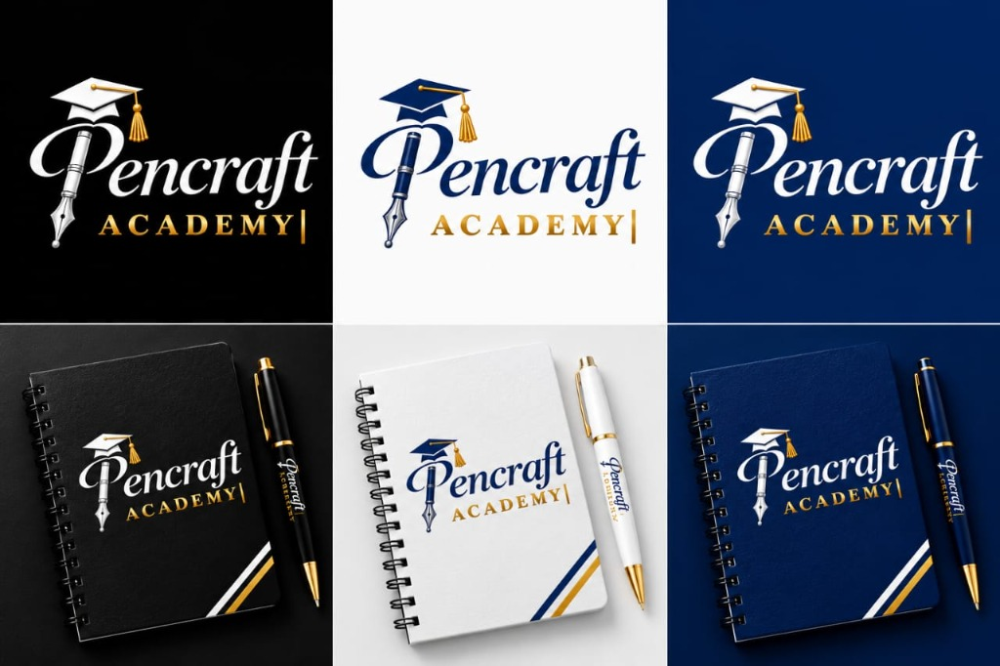

# 🎓 Pencraft Academy

**Turning Ideas Into Skills. Turning Skills Into Value.**

Pencraft Academy is a learning and skills-development initiative that helps learners gain practical knowledge, develop useful skills, and prepare for educational, professional, and entrepreneurial opportunities.



## ✨ Features

- **Modern, responsive website** — Navy blue, warm gold, and white theme
- **Penny AI Assistant** — Built-in chatbot powered by Google Gemini to help navigate the site and answer questions
- **Course catalog** — Writing, Research, Digital Marketing, AI & Tools, Freelancing
- **Certification system** — Master, Senior, Intermediate, Apprentice, Participation levels
- **Foundational Charter** — Full governance, rights, and disciplinary framework
- **Apply for a Course** — Direct link to the enrollment form

## 🚀 Quick Start

### Prerequisites
- [Node.js](https://nodejs.org/) v18 or higher

### Installation

```bash
git clone https://github.com/YOUR_USERNAME/pencraft-academy.git
cd pencraft-academy
npm install
```

### Configuration

Create a `.env` file in the root directory:

```env
GEMINI_API_KEY=your_gemini_api_key_here
PORT=3000
```

### Run

```bash
npm start
```

Visit `http://localhost:3000` in your browser.

## 🛠️ Tech Stack

- **Backend:** Node.js + Express
- **Frontend:** Vanilla HTML, CSS, JavaScript
- **AI:** Google Gemini API (Penny chatbot)
- **Fonts:** Montserrat, Cormorant Garamond, Caveat
- **Security:** Helmet, CORS, Rate Limiting

## 📁 Project Structure

```
pencraft-academy/
├── server.js              # Express backend + Gemini API proxy
├── .env                   # API keys (not committed)
├── package.json
├── public/
│   ├── index.html         # Main website
│   ├── css/styles.css     # All styling
│   ├── js/
│   │   ├── main.js        # Navigation, animations, interactions
│   │   └── penny.js       # AI chatbot client
│   └── images/
│       └── logo.jpg       # Academy logo
```

## 👤 Founded By

**Osuigwe Wisdom Munachimso** (Prince Noble)

## 📄 License

© 2026 Pencraft Academy. All rights reserved.
